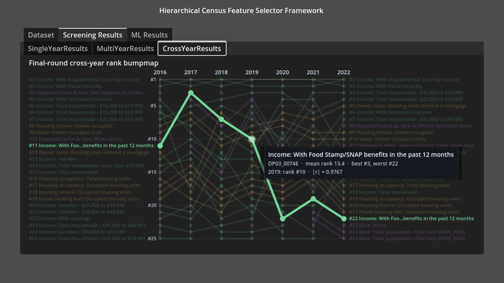
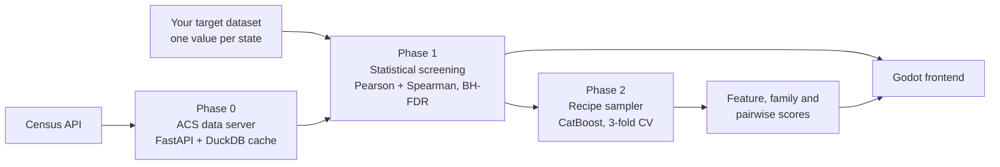
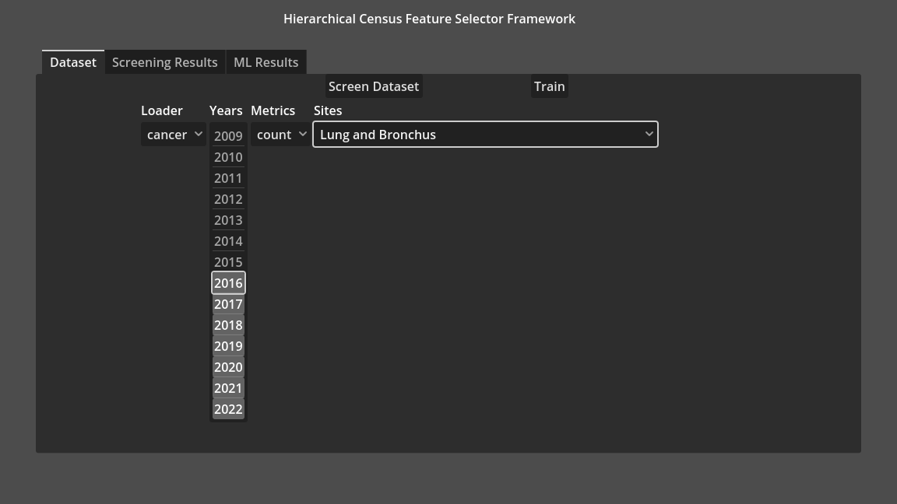
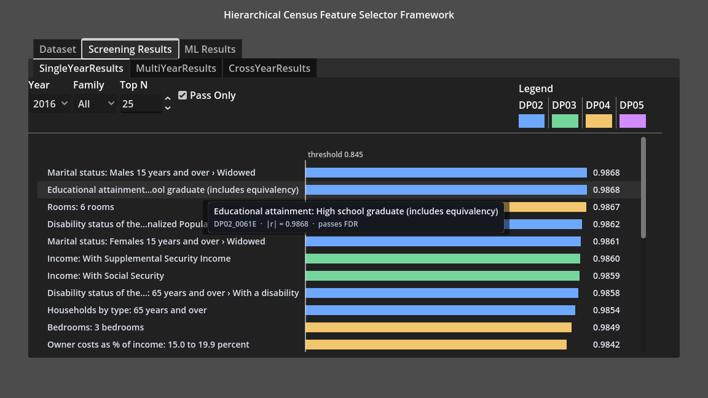
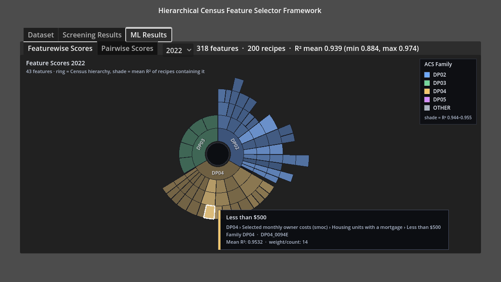
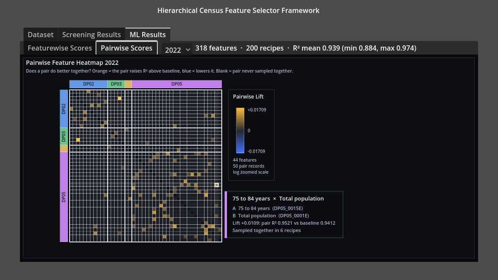

# Hierarchical Feature Selection over U.S. Census Data

Give it any state-level dataset (cancer incidence, overdose deaths, UFO sightings) and it finds which of the ~528 American Community Survey (ACS) variables, and which *families* of variables, best explain it.



*M.S. Computer Science capstone, California State University, Fullerton (2026). Advisor: Dr. Kanika Sood. [Full report (PDF)](docs/FinalReport.pdf)*

### Live demo

**[▶ Try it in your browser](https://udargit829.github.io/US-Map-Census-Prediction/demo/)**: the full frontend running on precomputed results for lung cancer, opioid overdoses and UFO sightings. No install needed. Hover anything for details.

---

## The problem

Census data has a wide-data problem. Each state has roughly **528 usable ACS estimate variables**, but there are only **51 rows** (50 states plus DC). Fit a model on all of them and it will find patterns that aren't real.

Leaf-level correlation alone doesn't work well either. Many ACS variables are restatements of population size: total housing units, total households and total population. Anything that scales with population (cancer cases, sightings) correlates with all of them at |r| ≈ 0.99. The useful signal is in which variables still matter **in combination** once those are accounted for.

## How it works



| Phase | What it does |
|---|---|
| **0: Data server** | Fetches ACS 5-year Data Profile tables (DP02 social, DP03 economic, DP04 housing, DP05 demographic), about 4,200 variables per geography and year, and caches them in DuckDB so the Census API is hit only once. |
| **1: Screening** | Correlates every variable with the target (Pearson for linear and Spearman for monotonic relationships), corrects for ~500 simultaneous tests with Benjamini-Hochberg FDR, and iterates until the shortlist converges. |
| **2: Recipe sampling** | Repeatedly samples small random subsets ("recipes") of the screened features, scores each with a 3-fold cross-validated CatBoost model, and aggregates the scores to the **feature**, **family** and **pairwise** level. This surfaces variables that are weak alone but strong together. |

CatBoost was chosen for its ordered boosting, which reduces target leakage at small *n*, and its symmetric trees, whose results stay comparable across many retrains on different feature subsets.

## Screenshots

| Choose a dataset | Single-year screening (hover for full label) |
|---|---|
|  |  |

| Feature scores by Census hierarchy | Pairwise lift: which pairs help each other |
|---|---|
|  |  |

## Results

Validated on three target datasets that relate to the Census in very different ways:

- **Lung and bronchus cancer incidence:** strong, stable signal. In 2022, 200 CatBoost recipes over 318 screened features averaged R² 0.939 (min 0.884, max 0.974).
- **Opioid overdose deaths:** mean R² near zero, but individual recipes reach about 0.6. Real signal exists, but it's sparse.
- **UFO sightings** (a stress test): in 2013 the mean R² is 0.17 and the best recipes reach 0.80. The signal then erodes every year until it collapses in 2016 (mean −0.87, best 0.04). I traced this to a change in how the source (NUFORC) releases its data, not to the method.

All three runs can be explored in the [live demo](#live-demo).

The full methodology, statistics and discussion are in the [report](docs/FinalReport.pdf).

---

## Running it

You need **Python 3.10+** and a free **Census API key** ([request one here](https://api.census.gov/data/key_signup.html)).

### 1. Install

```bash
git clone https://github.com/UdarGIT829/US-Map-Census-Prediction.git
cd US-Map-Census-Prediction/server
python -m venv .venv
source .venv/bin/activate        # Windows: .venv\Scripts\activate
pip install -r requirements.txt
```

### 2. Start the two backend servers

Each one runs in its own terminal, from `server/`, with the venv active:

```bash
export CENSUS_API_KEY=your_key_here   # Windows: set CENSUS_API_KEY=your_key_here
python screening_api.py               # Phase 0 + 1, port 11650
```

```bash
python ml_api.py                      # Phase 2, port 11651
```

Check that they're up: `curl localhost:11650/health` and `curl localhost:11651/health` should both return `{"status":"ok", ...}`.

> **First run is slow.** The ACS cache starts empty, so the first screening for a given year downloads every variable from the Census API. Later runs read from the local DuckDB cache.

### 3. Start the frontend

Either download a prebuilt binary from [Releases](../../releases) (Linux `frontend.x86_64` or Windows `frontend.exe`), or open `frontend/` in **Godot 4.4** and press Play.

Then:
1. **Dataset** tab: pick a loader (for example `cancer`), a metric, a site (for example `Lung and Bronchus`) and one or more years.
2. Click **Screen Dataset**. Results appear under **Screening Results** (single year, multi-year heatmap and cross-year rank chart).
3. Click **Train** to run the CatBoost recipe sampler. Results appear under **ML Results**.

Hover any feature to see its full Census label, variable code and scores.

### Bundled datasets

`server/phase_1/input/` includes the three validation datasets:
- CDC U.S. Cancer Statistics incidence, 1999–2022
- Opioid overdose deaths, 2018–2023
- NUFORC UFO sightings by state

---

## Project layout

```
server/
  screening_api.py          FastAPI: Phase 0 + 1 (port 11650)
  ml_api.py                 FastAPI: Phase 2 (port 11651)
  dry_run_iterative_screening.py   screening loop + loader factory
  data_server/              Census API client, DuckDB cache
  phase_1/                  dataset assembly, loaders, screening
  phase_2/                  feature pool, dataset rebuild, CatBoost recipe sampler
frontend/                   Godot 4.4 project
docs/                       report and screenshots
```

## Tech stack

Python · FastAPI · DuckDB · pandas · scikit-learn · statsmodels · CatBoost · Godot 4 (GDScript)

## Limitations and next steps

- **BH-FDR didn't change which features passed** at these sample sizes. A different multiple-testing approach, or none, is worth comparing.
- **State level only** in the frontend. County-level data exists in Phase 0, but counties per state vary widely (Delaware has 3).
- **Other models.** Alternatives to CatBoost would need stricter target normalization and full geographic coverage.

## Author

**Viraat Udar**: [github.com/UdarGIT829](https://github.com/UdarGIT829)
